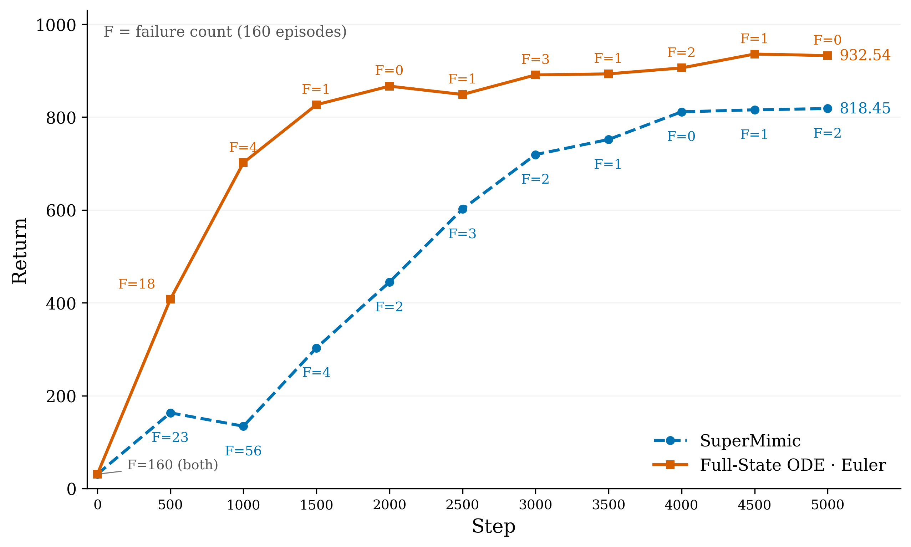

# SuperMimic on LocoMuJoCo: ODE world models and anti-saturation

Whole-body motion tracking for Unitree H1 across 40 LAFAN1 motions. One world model learns the dynamics; one policy improves through 32-step differentiable imagination.

Our two additions are **a full-state ODE world model** and **anti-saturation regularization (AS)**. The ODE predicts joint accelerations and reconstructs body features with differentiable forward kinematics. AS supplies a restoring gradient when raw policy outputs grow into the saturated region of `tanh`.

## Results

All rows below use Tanh action output, a fixed 5,000-iteration checkpoint, 51.20M training transitions, and the same 160 evaluation starts. Return is the mean episode sum; Error is relative-site position error in meters; Failures counts absorbing terminations. Lower failure count and tracking error are better.

| Method | Seed | Return ↑ | Error (m) ↓ | Failures / 160 ↓ |
|---|---:|---:|---:|---:|
| SuperMimic | 42 | 818.45 | 0.1358 | 2 |
| SuperMimic | 43 | 858.83 | 0.0932 | 2 |
| SuperMimic | 44 | 811.37 | 0.0937 | 17 |
| Full-State ODE Euler | 42 | 932.54 | 0.0842 | 0 |
| Full-State ODE Euler | 43 | 878.71 | 0.0818 | 15 |
| Full-State ODE Euler | 44 | 921.41 | 0.0810 | 0 |
| Full-State ODE Euler + AS | 42 | 914.58 | 0.0850 | 1 |
| Full-State ODE Euler + AS | 43 | 935.38 | 0.0816 | 0 |
| Full-State ODE Euler + AS | 44 | 928.36 | 0.0810 | 0 |

**ODE improves tracking and learns faster early in training.** At 2k, seed 42 reaches return 866.72 versus 444.76 for the MLP baseline. At 5k, Euler improves return and tracking error over the baseline for all three seeds, though seed 43 still has 15 failures.

**AS helps the difficult seed without changing the environment reward.** For Euler seed 43, AS raises return from 878.71 to 935.38 and removes all 15 failures. Across the three seeds, total failures fall from 15/480 to 1/480. It is not a uniform score boost: seed 42 becomes slightly worse, while seed 44 improves modestly.



Midpoint seed 42 reaches **935.28 / 0.0783 m / 0 failures**; with AS it reaches **931.53 / 0.0800 m / 1 failure**. Its tracking error is lower than Euler's, at a higher compute cost. Accelerated Midpoint runs for seeds 42–44, with and without AS, are in progress; they are not included as completed results.

[ODE result table](results/ode_summary_5k.csv) · [ODE learning curves](results/ode_learning_curves.csv) · [Seed-42 figure data](results/learning_curve_seed42.csv) · [Earlier experiments](results/summary_5k.csv)

Every completed ODE run includes its full 160-episode evaluation and provenance in `results/`. The archived seed-42 ODE runs use microbatch 512 without FK reuse; seeds 43/44 use microbatch 1024 with FK reuse. The baseline seed-42 run resumed at iteration 300 with rebuilt replay. Details are in [the protocol](docs/protocol.md).

## Method

**Full-state dynamics.** The vector field takes 267 state features and 19 actions. It predicts 25 generalized accelerations and a termination logit. Euler or Midpoint integrates the 51-dimensional physical state (26 positions, including a quaternion, and 25 velocities). Differentiable FK reconstructs the remaining body features. The WM fits physical-state prediction error and termination BCE; the actor differentiates through the rollout and its learned survival weights.

**Anti-saturation.** For raw decoder output `u`, the actor objective adds:

```text
L_AS = 0.01 * mean(relu(abs(u) - 1)^2)
```

The penalty is evaluated at real replay starts. It acts before `tanh`, so it can pull large decoder outputs back toward a useful-gradient range. WM loss, critic targets, simulator reward and termination stay unchanged. AS is optional and also available for the MLP baseline.

**Execution.** ODE runs default to microbatch 1024 and reuse each freshly computed successor's FK features at the next field evaluation. Midpoint still computes new FK at its intermediate state. Gradients remain connected. Total actor batch stays 4096; Python gradient accumulation is retained because a JIT-scan version did not improve speed. Accelerated Euler measured about 2.35–2.44 seconds per training iteration on an L40S; early accelerated Midpoint measurements are about 3.63–3.69 seconds.

## Setup

Tested on Linux, Python 3.12, CUDA 12 and L40S. Replay is stored in host memory; the 4096-environment configuration needs substantial host RAM.

```bash
python3.12 -m venv .venv
source .venv/bin/activate
pip install -r requirements.txt
git clone https://github.com/robfiras/loco-mujoco.git external/loco-mujoco
git -C external/loco-mujoco checkout 3921fedbca93876c0595c90c535b24ec08ff623d
pip install -e external/loco-mujoco
```

Motion names are in `configs/lafan1_40.json`. LocoMuJoCo fetches the dataset on first use. To reuse local assets, pass `--variables configs/variables.yaml` with:

```yaml
LOCOMUJOCO_CONVERTED_LAFAN1_PATH: /absolute/path/to/converted_lafan1
LOCOMUJOCO_MODELS_PATH: /absolute/path/to/robot_models
```

## Train and evaluate

```bash
# Tanh + full-state Euler
python scripts/train.py --method ode --solver euler --seed 43 --gpu 0 --out runs/euler_s43

# Add AS; use --solver midpoint for the other integrator
python scripts/train.py --method ode --solver euler --seed 43 --gpu 1 \
  --saturation-weight 0.01 --saturation-threshold 1 --out runs/euler_as_s43

# SuperMimic MLP baseline; AS can be added with the same flags
python scripts/train.py --method baseline --seed 43 --gpu 2 --out runs/mlp_s43

python scripts/evaluate_checkpoint.py runs/euler_s43/checkpoints/iter_5000.pkl \
  --gpu 0 --out runs/euler_s43/reevaluation
```

Default budget: 5k iterations, 4096 environments, alternating 3/2 real steps per iteration, WM batch 2048 × 10 updates, WM window 8, imagination batch 4096 × horizon 32, and 20 critic updates. There are 262,144 additional warmup transitions. Checkpoints are saved every 100 iterations and evaluations every 1000. Add `--smoke` for six full-size updates in a separate output directory. `--resume` restores model/optimizer state and rebuilds replay.

Legacy `experts`, `sensitivity`, `trust`, linear-output and head-reset experiments remain available; see [methods](docs/methods.md). ODE experiments use Tanh action output.

## Layout

```text
supermimic/
  train.py                 MLP baseline and earlier WM ablations
  train_ode.py             ODE training loop
  ode_world.py             Euler/Midpoint dynamics and differentiable FK
  adapter.py, evaluate.py  shared simulator interface and evaluation
  models.py, ...           shared actor, critic and utilities
scripts/                   common launcher, evaluation and result tools
configs/                   motion manifest
results/                   evaluation records, curves and provenance
docs/                      method details and protocol
```

No per-seed code copies, checkpoints or datasets are stored here.

## References

This is an independent H1/LAFAN1 port of [SuperMimic](https://supermimic.github.io/), with our ODE and AS experiments. It uses [LocoMuJoCo](https://github.com/robfiras/loco-mujoco) for the simulator, motion interface and native reward. [supermimic_vibed](https://github.com/zita-ch/supermimic_vibed) and [SuperMimic-Reproduced](https://github.com/CuboiLeo/SuperMimic-Reproduced) informed implementation checks. Dataset and robot assets retain their upstream licenses.
